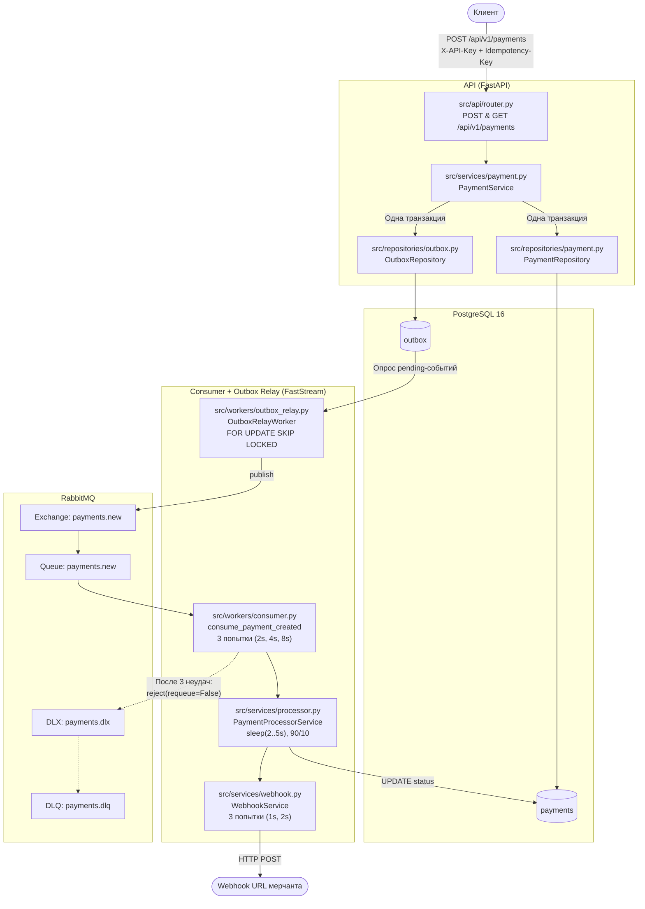

# Асинхронный сервис процессинга платежей

Сервис принимает запросы на оплату по HTTP, сохраняет платеж и событие в PostgreSQL в одной транзакции (Transactional Outbox), фоново публикует задачу в RabbitMQ, эмулирует ответ платежного шлюза (2–5 сек, 90% `succeeded` / 10% `failed`) и отправляет результат мерчанту по вебхуку.

## Стек
- Python 3.12 (`uv`), FastAPI, Pydantic v2
- SQLAlchemy 2.0 (`asyncpg`), Alembic, PostgreSQL 16
- RabbitMQ, FastStream (`faststream[rabbit]`), `httpx`
- Docker, Docker Compose, `ruff`, `pytest`

## Архитектура



### Как проходит платеж
1. **`POST /api/v1/payments`** проверяет заголовки `X-API-Key` и `Idempotency-Key`.
2. **`PaymentService`** внутри `async with session.begin():` создает строку в `payments` (`status = 'pending'`) и запись в `outbox` (`status = 'pending'`). Если `Idempotency-Key` уже существует с тем же телом запроса — возвращает существующий платеж (`202 Accepted`); если тело отличается — возвращает `409 Conflict`.
3. **`OutboxRelayWorker`** раз в секунду забирает пачку необработанных событий запросом `SELECT ... FROM outbox WHERE status = 'pending' ORDER BY created_at ASC LIMIT 50 FOR UPDATE SKIP LOCKED`, публикует их в `payments.new` и помечает `published`.
4. **Консьюмер FastStream** читает сообщение из `payments.new`, ждет от 2 до 5 секунд, с вероятностью 90% ставит `succeeded` (10% — `failed`), записывает `processed_at` в БД и отправляет POST-запрос на `webhook_url` (до 3 попыток с паузами 1с и 2с).
5. Если обработка или доставка вебхука падает, консьюмер повторяет попытку 3 раза с экспоненциальной задержкой (`2s`, `4s`, `8s`), после чего делает `msg.reject(requeue=False)`, и RabbitMQ перекладывает сообщение через `payments.dlx` в очередь `payments.dlq`.

---

## Быстрый старт

```bash
# При необходимости можно скопировать .env.example в .env
# (в docker-compose.yml уже прописаны те же значения по умолчанию)
cp .env.example .env

# Сборка и запуск postgres, rabbitmq, api, consumer
docker compose up --build
```

При старте `api` автоматически накатывает миграции (`alembic upgrade head`) и поднимается на `http://localhost:8000`.
- Swagger UI: http://localhost:8000/docs
- RabbitMQ UI: http://localhost:15672 (`guest` / `guest`)

---

## Примеры запросов (`curl`)

### 1. Создание платежа (`202 Accepted`)
В сервисе есть тестовый приемник `http://api:8000/webhooks/mock`, который принимает вебхуки внутри Docker-сети и отвечает `200 OK`:

```bash
curl -i -X POST "http://localhost:8000/api/v1/payments" \
  -H "Content-Type: application/json" \
  -H "X-API-Key: dev-secret-api-key" \
  -H "Idempotency-Key: order-1001" \
  -d '{"amount":"1500.50","currency":"RUB","description":"Order #1001","metadata":{"order_id":"1001"},"webhook_url":"http://api:8000/webhooks/mock"}'
```

Ответ:
```json
{
  "payment_id": "7c9e6679-7425-40de-944b-e07fc1f90ae7",
  "status": "pending",
  "created_at": "2026-11-22T22:00:00.123456Z"
}
```

### 2. Получение статуса платежа (`200 OK`)
Через 2–5 секунд платеж перейдет в `succeeded` (90%) или `failed` (10%):

```bash
curl -i "http://localhost:8000/api/v1/payments/<PAYMENT_ID>" \
  -H "X-API-Key: dev-secret-api-key"
```

### 3. Повтор с тем же `Idempotency-Key` и тем же телом (`202 Accepted`)
Вернет тот же самый `payment_id`, дубль в БД и очереди не создается:

```bash
curl -i -X POST "http://localhost:8000/api/v1/payments" \
  -H "Content-Type: application/json" \
  -H "X-API-Key: dev-secret-api-key" \
  -H "Idempotency-Key: order-1001" \
  -d '{"amount":"1500.50","currency":"RUB","description":"Order #1001","metadata":{"order_id":"1001"},"webhook_url":"http://api:8000/webhooks/mock"}'
```

### 4. Повтор с тем же `Idempotency-Key`, но другой суммой (`409 Conflict`)

```bash
curl -i -X POST "http://localhost:8000/api/v1/payments" \
  -H "Content-Type: application/json" \
  -H "X-API-Key: dev-secret-api-key" \
  -H "Idempotency-Key: order-1001" \
  -d '{"amount":"9999.00","currency":"RUB","description":"Order #1001","metadata":{"order_id":"1001"},"webhook_url":"http://api:8000/webhooks/mock"}'
```

### 5. Проверка ретраев и Dead Letter Queue (`payments.dlq`)
Если передать недоступный `webhook_url`, консьюмер обновит статус платежа в БД, сделает 3 попытки с задержками 2с, 4с, 8с и отправит сообщение в `payments.dlq`:

```bash
curl -i -X POST "http://localhost:8000/api/v1/payments" \
  -H "Content-Type: application/json" \
  -H "X-API-Key: dev-secret-api-key" \
  -H "Idempotency-Key: order-dlq-test" \
  -d '{"amount":"50.00","currency":"USD","description":"DLQ test","metadata":{"test":"dlq"},"webhook_url":"http://localhost:9999/dead-webhook"}'
```

---

## Локальный запуск тестов и линтера

```bash
uv sync
uv run ruff check .
uv run ruff format --check .
uv run pytest -v
```

---

## Таблица трассировки требований (Requirements Traceability)

| Требование | Файл | Класс / Объект | Метод / Функция / Атрибут |
|---|---|---|---|
| HTTP-роутер, зависимости, Pydantic-схемы | `src/api/router.py`<br/>`src/api/dependencies.py`<br/>`src/api/schemas.py` | `APIRouter`<br/>`PaymentCreateRequest`<br/>`PaymentCreateResponse`<br/>`PaymentResponse` | `create_payment`<br/>`get_payment`<br/>`require_idempotency_key`<br/>`get_payment_service` |
| Бизнес-логика создания и чтения платежа | `src/services/payment.py` | `PaymentService`<br/>`IdempotencyConflictError`<br/>`PaymentNotFoundError` | `PaymentService.create_payment`<br/>`PaymentService.get_payment`<br/>`PaymentService._ensure_payload_matches` |
| Репозитории (`BaseRepository`, `PaymentRepository`, `OutboxRepository`) | `src/repositories/base.py`<br/>`src/repositories/payment.py`<br/>`src/repositories/outbox.py` | `BaseRepository`<br/>`PaymentRepository`<br/>`OutboxRepository` | `PaymentRepository.create`<br/>`PaymentRepository.get_by_id`<br/>`PaymentRepository.get_by_idempotency_key`<br/>`PaymentRepository.update_status`<br/>`OutboxRepository.add_event`<br/>`OutboxRepository.fetch_unprocessed_with_lock`<br/>`OutboxRepository.mark_processed`<br/>`OutboxRepository.increment_retry` |
| Модель `Payment` (таблица `payments`, JSONB `"metadata"` -> `payment_metadata`) | `src/models/payment.py`<br/>`src/models/enums.py` | `Payment`<br/>`Currency`<br/>`PaymentStatus` | `id`, `amount`, `currency`, `description`, `payment_metadata`, `status`, `idempotency_key`, `webhook_url`, `created_at`, `processed_at` |
| Модель `OutboxEvent` (таблица `outbox`) | `src/models/outbox.py`<br/>`src/models/enums.py` | `OutboxEvent`<br/>`OutboxStatus` | `id`, `aggregate_id`, `event_type`, `payload`, `status`, `retry_count`, `created_at`, `processed_at` |
| Асинхронные миграции Alembic | `alembic/env.py`<br/>`alembic/versions/20261122_0001_initial_payments_and_outbox.py` | — | `run_async_migrations`<br/>`upgrade`<br/>`downgrade` |
| Аутентификация `X-API-Key` (`401 Unauthorized`) | `src/core/security.py`<br/>`src/api/router.py` | `APIKeyHeader` | `is_valid_api_key`<br/>`verify_api_key` |
| Transactional Outbox Relay (`SELECT ... FOR UPDATE SKIP LOCKED`) | `src/workers/outbox_relay.py`<br/>`src/repositories/outbox.py` | `OutboxRelayWorker`<br/>`OutboxRepository` | `OutboxRelayWorker.process_batch`<br/>`OutboxRelayWorker.run_forever`<br/>`OutboxRepository.build_fetch_unprocessed_stmt` |
| Топология RabbitMQ (`payments.new`, `payments.dlx`, `payments.dlq`) | `src/workers/consumer.py` | `RabbitBroker`<br/>`RabbitExchange`<br/>`RabbitQueue` | `payments_exchange`<br/>`payments_queue`<br/>`dlx_exchange`<br/>`dlq_queue`<br/>`declare_dlq_topology` |
| Консьюмер, ретраи (3 попытки: 2s, 4s, 8s) и отправка в DLQ | `src/workers/consumer.py` | `FastStream` | `consume_payment_created`<br/>`process_message_with_retry`<br/>`compute_consumer_backoff` |
| Эмуляция платежного шлюза (2–5с, 90% `succeeded` / 10% `failed`) | `src/services/processor.py` | `PaymentProcessorService` | `PaymentProcessorService.process_payment`<br/>`PaymentProcessorService._choose_terminal_status` |
| Отправка HTTP POST вебхука с ретраями и backoff | `src/services/webhook.py` | `WebhookService`<br/>`WebhookDeliveryError` | `WebhookService.send_payment_webhook`<br/>`WebhookService._deliver_with_retries`<br/>`WebhookService.compute_backoff_seconds` |
| Конфигурация, JSON-логирование и сессии БД | `src/core/config.py`<br/>`src/core/logging.py`<br/>`src/core/database.py` | `Settings`<br/>`JsonFormatter` | `get_settings`<br/>`setup_logging`<br/>`create_db_engine`<br/>`create_session_factory`<br/>`get_db_session` |
| Docker и авто-миграции при старте | `Dockerfile`<br/>`docker-compose.yml`<br/>`.env.example` | — | `services.postgres`<br/>`services.rabbitmq`<br/>`services.api`<br/>`services.consumer` |
